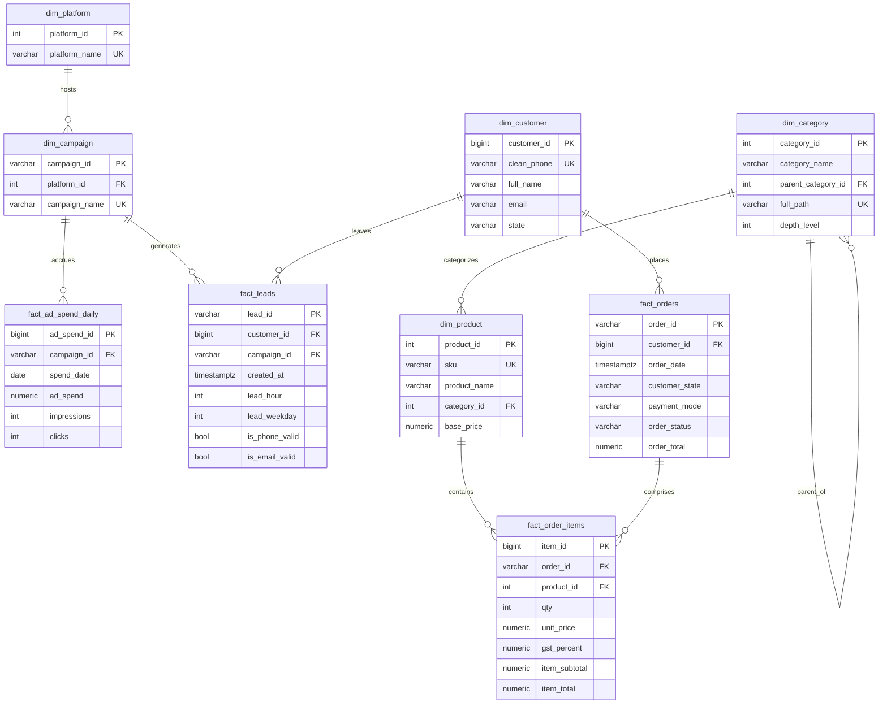

# Part B: 3NF Relational Model & Entity-Relationship Architecture
**Repository**: `problem2-warehouse`  
**Target Schema**: 3NF Normalized PostgreSQL Architecture

---

## 1. Entity-Relationship Diagram (ERD)

---

## 2. Normalization Steps (1NF, 2NF, 3NF)

### First Normal Form (1NF)
> **Definition**: Every column holds atomic, scalar values; no repeating groups; each table possesses a distinct Primary Key.
* **What we did**:
  1. Unpacked the composite string `category_path` (`'Men > Shirts > Linen'`) into a structured adjacency list (`dim_category`).
  2. Disaggregated multi-item orders from flat combined rows into dedicated discrete records in `fact_order_items`.
  3. Sanitized and converted string-wrapped numbers (`impressions`, `clicks`, `qty`, `gst_percent`) into native integer and numeric types.
  4. Added explicit Primary Keys (`PK`) to every single table.

### Second Normal Form (2NF)
> **Definition**: Meets 1NF, and all non-key attributes are fully functionally dependent on the entire primary key (no partial dependencies on a composite key).
* **What we did**:
  1. In the legacy table, `product_name`, `category_path`, and `unit_price` depended solely on `product_sku`, yet were duplicated across every order item. These were isolated into `dim_product`.
  2. Ad spend metrics (`ad_spend`, `impressions`, `clicks`) depended only on `(campaign_id, date)` rather than the order line items. They were extracted into `fact_ad_spend_daily`, completely curing the 10.61x spend duplication.

### Third Normal Form (3NF)
> **Definition**: Meets 2NF, and no non-key attribute is transitively dependent on another non-key attribute (no non-key -> non-key dependencies).
* **What we did**:
  1. `platform` was transitively dependent on `campaign_name` (`order_id` -> `campaign_id` -> `platform_name`). We decoupled platforms into `dim_platform` and linked `dim_campaign` via foreign key `platform_id`.
  2. Customer profile details (`full_name`, `email`, `state`) were transitively dependent on `lead_phone`. We decoupled customers into `dim_customer`, referencing `customer_id` from orders and leads.

---

## 3. Constraints & Data Integrity Guardrails

1. **PRIMARY KEY**: Enforces unique identification for every entity (`dim_campaign(campaign_id)`, `fact_orders(order_id)`, `dim_customer(customer_id)`, etc.).
2. **FOREIGN KEY**: Guarantees referential integrity with cascading control (`fact_order_items` -> `fact_orders(order_id)` `ON DELETE CASCADE`).
3. **NOT NULL**: Mandates critical operational attributes (`order_date`, `spend_date`, `clean_phone`, `order_status`).
4. **UNIQUE**: Prevents duplicate insertions (`clean_phone`, `(campaign_id, spend_date)`, `sku`, `full_path`).
5. **CHECK Constraints**:
   - `ad_spend >= 0.00`
   - `qty > 0`
   - `gst_percent BETWEEN 0.00 AND 100.00`
   - `clean_phone ~ '^[6-9][0-9]{9}$'` (Indian 10-digit mobile specification)
   - `order_status IN ('DELIVERED', 'PROCESSING', 'CANCELLED', 'RETURNED')`
